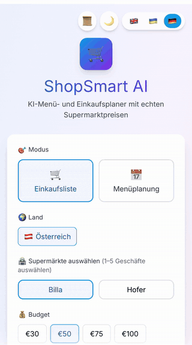
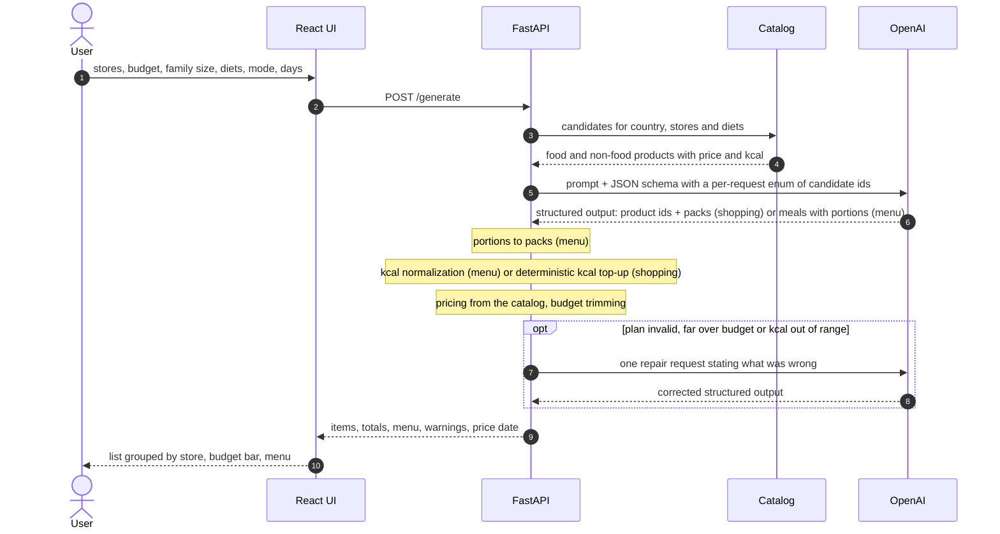
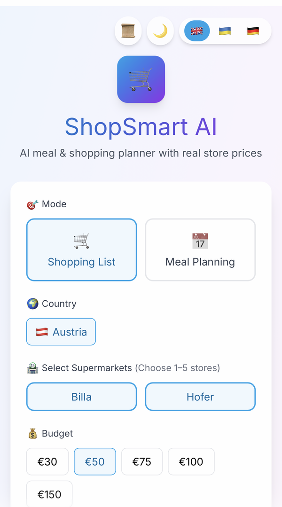
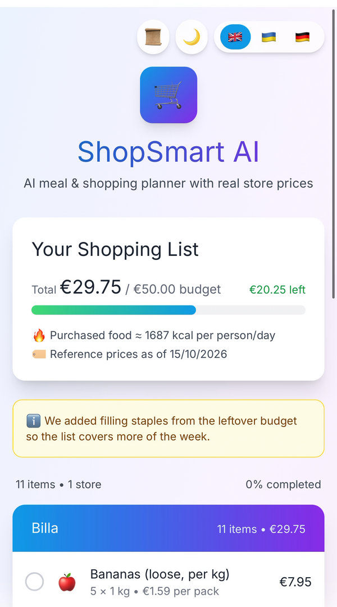
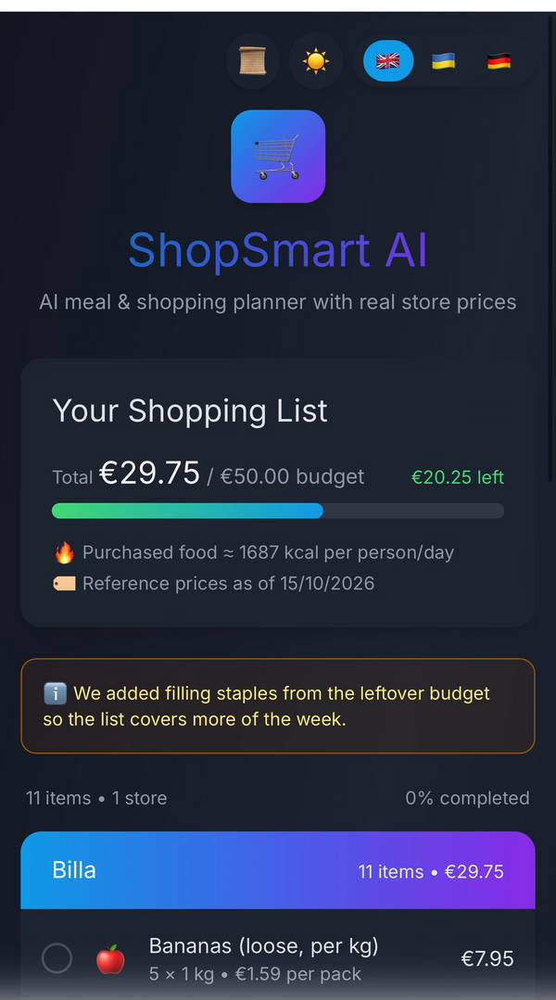
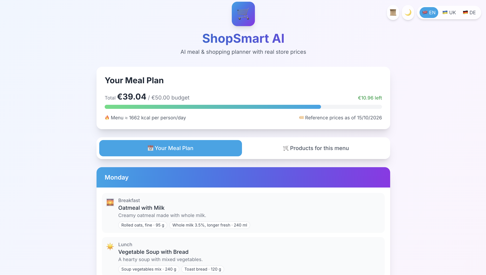

# ShopSmart AI

[](https://github.com/IvanSytnik/shopsmart-ai/actions/workflows/ci.yml)
[](LICENSE)
[](backend/requirements.txt)
[](frontend/package.json)

Budget-safe shopping lists and meal plans for Austrian supermarkets, and a price comparison of your own list across stores.

**[Live demo → shopsmart.sytnik-studio.com](https://shopsmart.sytnik-studio.com)**

**Contents:** [The problem with v1](#the-problem-with-v1) · [How it works](#how-it-works) · [Measured quality](#measured-quality) · [Features](#features) · [Tech stack](#tech-stack) · [Folder overview](#folder-overview) · [Run locally](#run-locally) · [Tests](#tests) · [Evals](#evals) · [Deployment](#deployment) · [Security](#security) · [Limitations](#limitations) · [Screenshots](#screenshots) · [Roadmap / Later](#roadmap--later) · [Academic note](#academic-note) · [License](#license)

<p align="center"></p>

For plans, an LLM picks the products, the server prices them from a dated catalog and guarantees the total fits your budget. The comparison makes no LLM call: the server prices your list at each store from the same catalog.

## The problem with v1

The first version (2025) asked the model for a complete shopping list as free text and parsed the JSON out of it. The model **invented prices and calorie values**, the total was whatever the model wrote, and **the budget was never checked**: a "€50" list could cost €70 in a real store, or feed a family for two days instead of seven. Nothing in the response could be traced back to a real price.

## How it works

Three modes, one catalog. No price, total or calorie number comes from a model.

| Mode | Endpoint | LLM | Result | `RATE_LIMIT`, `DAILY_GENERATE_CAP` |
|---|---|---|---|---|
| Shopping list, 7 days | `POST /generate`, `mode: shopping` | picks products and packs | list within budget, kcal top-up | yes |
| Meal plan, 1–7 days | `POST /generate`, `mode: menu` | picks dishes and portions per person | menu, and the list its portions need, within budget | yes |
| Price comparison | `POST /compare` | none | your list priced at each store, and the cheapest split | no |

### Shopping list and meal plan: the LLM chooses, the server computes

The model only picks product ids from a candidate list and says how much of each; everything numeric is done in Python from the catalog.



Deterministic guarantees (enforced by the server and covered by tests, independent of what the model returns):

- **Total ≤ budget.** If the priced plan is over budget, the server trims packs, then whole lines (snacks, drinks, frozen and non-food first). Every cut is listed in `trimmed`.
- **Diet filter.** Only products carrying every chosen diet tag (vegetarian, vegan, gluten-free, lactose-free) are offered to the model, and the id enum means nothing else can come back (non-food such as cleaning products is always allowed).
- **Only catalog products.** Product ids are a JSON-schema enum built per request from the candidates; unknown ids are rejected.
- **kcal floor of 1600 per person and day.** In menu mode, portions are scaled up (or down above 3500) to land in range. In shopping mode, the server tops the list up one pack at a time with the food that gives the most kcal per € while the budget allows (`kcal_topped_up`). If the floor can't be reached within the budget, the response carries a `low_kcal` warning instead of breaking the budget.

The full pipeline (candidate selection on tight budgets, portion rules, repair conditions, trimming order, top-up limits), request and response fields and error codes are in [docs/API.md](docs/API.md).

### Price comparison: no LLM at all

You build the list; the server prices it. Same list, same catalog, same day: same answer, in milliseconds, without an OpenAI call.

- **Concepts.** Every product has a `concept_id` shared by the products a shopper would buy in place of each other, in any store: `milk_whole` covers fresh and UHT milk of any brand. The catalog has 68 concepts; 11 are sold by both Billa and Hofer. Each has a neutral, brand-free name in en, uk and de from `data_src/concepts_at.csv` (`Butter`, not `Clever Teebutter`). The autocomplete matches that name in all three languages and the products' own names (brands, variants), ignoring case and accents.
- **Pack sizes.** `quantity` counts the concept's `reference_pack_size`, its smallest pack in the country. Each store buys the fewest whole packs that hold at least that much: 2 × yogurt (smallest pack 250 g) is 2 × 250 g at Billa and 1 × 500 g at Hofer, so totals compare the same amount.
- **Which product.** Within a store, the lowest `line_total_eur` for that amount wins; ties go to the lower price per kg, l or piece. A cheaper-per-kg 1 kg pack doesn't win when 250 g were asked for and a 250 g pack costs less.
- **Single store or split.** `single_store_rankings` ranks the stores by missing items, then total. `split_basket` takes every item from the store where it costs least (cherry-picking). Savings compare the same items: what a store charges above the split for the items it has.
- **Recommendation.** `split_basket` only if the split uses more than one store and saves at least `min_split_savings_eur` (default €3.00) over the best single store; otherwise `single_store` with that store. A second trip has to be worth it.
- **Today's prices.** A catalog row can carry a promotion: `promo_price_eur` and its last day `promo_valid_until` next to `regular_price_eur`. `ProductCatalog` re-prices by today's date, so an ended promotion falls back to the regular price without a rebuild or restart; plans from `/generate` use the same prices.

Rules, fields and an example: [docs/API.md](docs/API.md#compare-a-shopping-list).

## Measured quality

20 fixed scenarios (shopping and menu mode, 1–7 days, 1–5 people, €15–150, every diet, en/de/uk, two deliberately tight budgets), real OpenAI calls, real catalog. Baseline = first run of the v2 pipeline; final = the release.

| Metric | Baseline [`20261015T141547Z`](backend/evals/results/20261015T141547Z.json) | Final [`20261018T221443Z`](backend/evals/results/20261018T221443Z.json) |
|---|---|---|
| Valid output rate | 100% | 100% |
| Budget adherence | 100% | 100% |
| Diet violations | 0 | 0 |
| Menu kcal in range | 54.5% | 90.9% |
| Shopping kcal in range (purchased) | n/a | 88.9% |
| First-attempt acceptance, shopping | 66.7% | 100% |
| First-attempt acceptance, menu | 54.5% | 81.8% |
| Latency p50 / p95 | 7.45 s / 21.21 s | 4.09 s / 15.40 s |
| Cost per request (avg) | $0.00143 | $0.00108 |

Budget and diet were already guaranteed in the baseline, because the server enforces them. Between the two runs the work went into plan quality: on tight budgets the most expensive calories are no longer offered to the model (vegetables and fruit exempt); small overshoots (≤ 10%) are trimmed instead of triggering a repair round trip; the menu output got shorter with `max_tokens` sized per request; menus are kcal-normalized by scaling portions; and shopping lists get a deterministic kcal top-up (5 of 9 lists were topped up). Runs that needed trimming went from 7 to 3, and fewer repairs mean lower latency and cost.

The Hofer lactose-free miss of v2.0.0 (`shop-en-hofer-2p-40-lactose-free`, 1200 kcal) was a catalog tagging bug, not a pipeline problem: 9 vegan products (breads and bakery) lacked the `lactose_free` tag, so lactose-free users never saw them. Fixed in v2.0.1 and enforced by the catalog build; the case now reaches 1601 kcal, and 3 of 3 repeats are in range ([`20261018T221227Z`](backend/evals/results/20261018T221227Z.json)).

The remaining misses are honest ones. The shopping miss is the deliberately tight `tight-shop-en-both-1p-15` (1 person, €15/week): 1427 kcal per person and day in the full run, where the LLM spent a third of the budget on mince, so the API returns `low_kcal` rather than going over budget; on repeat 4 of 5 runs are in range ([`20261018T221951Z`](backend/evals/results/20261018T221951Z.json)). The menu miss is the deliberately tight `tight-menu-en-both-5p-3d-40` (5 people, 3 days, €40): 1468 kcal, `low_kcal` + `budget_trimmed`.

Reports: [backend/evals/report.md](backend/evals/report.md) (the full run above, per-case table) and [backend/evals/results/](backend/evals/results/) (raw JSON for every run).

To reproduce: `cd backend && .venv/bin/python -m evals.run` ([backend/evals/run.py](backend/evals/run.py), scenarios in [backend/evals/cases.yaml](backend/evals/cases.yaml)). It needs `OPENAI_API_KEY`, writes `backend/evals/results/<timestamp>.json` and overwrites `backend/evals/report.md`. A new run uses the current catalog, not the `at-2026-10-15` one these numbers were measured on, and the model's picks vary between runs, so expect close but not identical numbers. Options and cost: [Evals](#evals).

The price comparison makes no model call, so there is nothing to eval: its rules (pack sizes, product choice, ranking, split, threshold, promotions by date) are covered by the 44 tests in [backend/tests/test_compare.py](backend/tests/test_compare.py).

## Features

- **Three modes**: a 7-day shopping list; a 1–7 day menu (breakfast, lunch, dinner, snack) with the shopping list derived from its portions; and **Compare**, a price comparison of a list you build yourself.
- **Compare a list across stores** (no LLM call, so no rate limit or daily cap): pick products by kind under neutral names (`Butter`, not a store brand), with a category filter, in packs (`2 × 250 g (500 g)`); choose stores, diets and the split threshold. See the list's price at each store (price per kg, l or piece, what a store lacks) and the cheapest split as a checklist per store, recommended only if it saves at least the threshold (default €3). The list is kept in `localStorage`.
- **Promotions**: plans and comparisons use the promo price while a promotion runs and the regular price after its last day. Compare shows a badge on a promoted item (regular price struck through, promo price, last day) and each store's promo savings.
- **Grounded prices**: per-store subtotals, a budget bar (used / remaining) and the catalog's price date on every plan.
- **Honest warnings**: trimmed products, kcal top-up and low-kcal notices.
- **Share links**, nothing stored on the server: a plan is compressed whole into the URL fragment (`/#/plan/<data>`) and opens read-only, as it was priced. A compare list (`/#/list/<data>`) carries only the list (`concept_id` and quantity per item, stores, diets, threshold, country), never prices, so it opens in the compare tab with the recipient's prices of the day.
- **History** of recent plans in `localStorage`; check off items while shopping; copy or print.
- **i18n**: English, Ukrainian and German, product names in all three, plurals via `Intl.PluralRules` (e.g. uk: 1 день, 3 дні, 5 днів).
- **Dark mode**, **mobile layout**, **accessibility**: labelled form controls and groups, `aria-pressed` toggle chips, `aria-invalid` fields with linked error text.

## Tech stack

- **Backend**: Python 3.11+, FastAPI, Pydantic v2 + pydantic-settings, OpenAI Python SDK (`AsyncOpenAI`, Structured Outputs), slowapi, pytest, ruff.
- **Frontend**: React 18, TypeScript (strict), Vite, Tailwind CSS, lz-string (share links), Vitest + Testing Library, ESLint.
- **Price scanner** (local only): Playwright, pypdfium2, Pillow, OpenAI Structured Outputs.
- **Infra**: Docker, nginx, GitHub Actions, Google Cloud Run, Cloudflare Pages.

## Folder overview

```
backend/
  app/
    main.py, config.py           # app factory, middleware; env-driven Settings
    api/                         # routers: health, generate, catalog (meta, concepts), compare
    schemas/                     # requests, responses, llm (LLM output), catalog, compare
    services/                    # llm, planner (prompt + repair), pricing, portions, limits,
                                 #   catalog (ProductCatalog: lookups at today's prices), comparison
    data/catalog.json            # generated price catalog (do not edit by hand)
  data_src/catalog_at.csv        # catalog source: one row per product, regular and promo price
  data_src/concepts_at.csv       # brand-free en/uk/de name of every concept_id
  scripts/build_catalog.py       # both CSVs -> catalog.json, with validation (--check in CI)
  scripts/price_scanner/         # weekly price/promo scanner, local only: cli, browser, adapters/
                                 #   (billa, hofer), extractors/ (OpenAI), updater (checks, review)
  requirements-scraper.txt       # scanner dependencies, not in the app or its Docker image
  tests/                         # pytest, OpenAI always mocked, network blocked
  tests/fixtures/catalog_small.json  # made-up catalog (Lidl, Penny) for pipeline tests
  tests/fixtures/catalog_at.csv  # frozen copy of catalog_at.csv (2026-10-15) for price and scanner tests
  evals/                         # offline eval runner, cases, reports
frontend/
  src/
    components/                  # form, mode selector, history, results/
    components/compare/          # CompareView, ConceptSearch, CompareResults, StoreRankings,
                                 #   SplitChecklist, MatchedItem (promo badge)
    hooks/                       # useCatalogMeta, useConcepts
    api.ts, types.ts             # API client; types mirror the backend schemas
    share.ts, compareList.ts     # share links (#/plan/, #/list/); the compare list in localStorage
    history.ts, translations.ts  # plan history; en/uk/de strings
deploy/                          # Cloud Run scripts, smoke test, deployment guide
docs/                            # API reference, catalog and scanner guide, roadmap, media
```

## Run locally

### Docker Compose

```bash
export OPENAI_API_KEY=sk-...
docker compose up --build
```

Frontend at http://localhost, API at http://localhost:8000.

### Manual

```bash
# backend
cd backend
python3 -m venv .venv && source .venv/bin/activate
pip install -r requirements.txt -r requirements-dev.txt
cp .env.example .env               # set OPENAI_API_KEY
uvicorn app.main:app --reload --port 8000

# frontend (second terminal)
cd frontend
npm ci
cp .env.example .env.local         # VITE_API_URL=http://localhost:8000
npm run dev                        # http://localhost:3000
```

API docs at http://localhost:8000/docs when `ENVIRONMENT=development`. For development without the real catalog, `CATALOG_PATH=tests/fixtures/catalog_small.json` uses the made-up test catalog.

<details>
<summary>Backend environment variables</summary>

```env
OPENAI_API_KEY=sk-your-api-key            # required
OPENAI_MODEL=gpt-4o-mini                   # default
OPENAI_TEMPERATURE=0.7                     # default
SHOPPING_MAX_TOKENS=1200                   # default; output token limit for a shopping list
MENU_MAX_TOKENS_BASE=600                   # default; menu limit = base + per_day × days
MENU_MAX_TOKENS_PER_DAY=450                # default
OPENAI_TIMEOUT_S=40                        # default; per OpenAI request
OPENAI_MAX_RETRIES=0                       # default; SDK retries on connection/5xx errors
REQUEST_DEADLINE_S=55                      # default; total time for one POST /generate
REPAIR_MIN_REMAINING_S=20                  # default; skip the repair retry if less is left
CATALOG_PATH=app/data/catalog.json         # default; price catalog, validated at startup
MIN_KCAL_PER_PERSON_DAY=1600               # default; menu mode repairs plans below this, shopping mode tops up
TOP_UP_MAX_PACKS_PER_PRODUCT=3             # default; shopping kcal top-up: packs added per product
TOP_UP_MAX_KCAL_SHARE=0.35                 # default; shopping kcal top-up: max share of one product in the target kcal
TOP_UP_IN_LIST_MIN_RATIO=0.7               # default; shopping kcal top-up: list items win at this share of the best kcal/€
MAX_KCAL_PER_PERSON_DAY=3500               # default; menu mode repairs portions above this
TIGHT_BUDGET_PER_PERSON_DAY=7.0            # default; below it costly calories aren't offered (0 = off)
TRIM_TOLERANCE=0.10                        # default; up to 10% over budget is trimmed, not repaired
MAX_SCHEMA_ENUM_VALUES=500                 # default; above it product ids aren't an enum in the LLM schema
CORS_ORIGINS=http://localhost:3000         # comma-separated; "*" is rejected
RATE_LIMIT=10/minute                       # default; per client IP on POST /generate
DAILY_GENERATE_CAP=200                     # default; POST /generate calls per UTC day
ENVIRONMENT=development                    # development | production (production disables /docs, /redoc, /openapi.json)
FORWARDED_ALLOW_IPS=127.0.0.1              # read by uvicorn; proxies trusted for X-Forwarded-For
```

`RATE_LIMIT` and `DAILY_GENERATE_CAP` apply only to `POST /generate`; `POST /compare` and the catalog endpoints make no OpenAI call. Docker Compose sets `CORS_ORIGINS=http://localhost,http://localhost:3000` by default. Behind a reverse proxy, set `FORWARDED_ALLOW_IPS` to the proxy's address so the rate limit sees the real client IP.

The price scanner reads the same `OPENAI_API_KEY` (environment or `backend/.env`) and its own optional settings, which the app ignores:

```env
SCANNER_MODEL=gpt-4o-mini                  # default
SCANNER_TEMPERATURE=0                      # default
SCANNER_MAX_TOKENS=6000                    # default; a busy flyer page lists 20–30 offers
SCANNER_TIMEOUT_S=120                      # default; per OpenAI request
SCANNER_MAX_RETRIES=2                      # default
SCANNER_CONCURRENCY=3                      # default; OpenAI calls at once
```

Frontend: `VITE_API_URL` is read at build time; `npm run dev` falls back to `http://localhost:8000`, production builds must set it.

</details>

### Price catalog

The app loads `backend/app/data/catalog.json`, generated from two hand-editable CSVs; edit the CSVs, never the JSON. Sources, method and disclaimer: [docs/CATALOG.md](docs/CATALOG.md).

```
data_src/catalog_at.csv   one row per product: store, concept_id, names, unit, pack size,
                          regular price, optional promo price and last day, nutrition per
                          100 g/ml, diet tags, source_url, price_date, verified
data_src/concepts_at.csv  concept_id, name_en, name_uk, name_de
        │
        └─> scripts/build_catalog.py ─> app/data/catalog.json
```

```bash
cd backend
python scripts/build_catalog.py          # validate both CSVs and write app/data/catalog.json
python scripts/build_catalog.py --check  # validate, and fail if catalog.json is out of date (CI)
```

Every row is validated with the app's Pydantic schema; any invalid row fails the build, which names its CSV line and writes nothing. Among the rules: unique ids; nutrition all set (food) or all empty (non-food); `pcs`/`pack` food needs `net_weight_g`; a `vegan` row must also be `vegetarian` and `lactose_free`; products sharing a `concept_id` have the same unit and category, and every concept has a name; a promotion needs both its price and its last day, a promo price below the regular price and a last day not before `price_date`. The catalog's `price_date` is the latest row's; there, `price_eur` is the price on that day (the promo price while the promotion runs) and `regular_price_eur` the CSV price.

#### Weekly price and promotion scanner

`backend/scripts/price_scanner/` reads current prices and promotions off the stores' pages and flyers and writes them into `catalog_at.csv`. It runs on your computer only: its dependencies are in `requirements-scraper.txt` (Playwright, pypdfium2, Pillow), not in `requirements.txt` or the Docker image, and nothing in `app/` imports it.

- **Browser profile.** `--login` opens Billa, Hofer, Roksh and Marktguru in a visible browser once: accept cookies, solve a captcha, pick your PLZ. The profile stays in `backend/.browser_profile/` (git-ignored; it holds your shop sessions).
- **Reading.** The browser opens every product's `source_url`, then the store's offers page, in one tab with 3–7 s pauses. An OpenAI model (`gpt-4o-mini`, Structured Outputs) reads the prices; it never computes them. Two ways:
  - *A product's own page* (`source_url`): the model gets only that product and reads only the page's main product, not "Ähnliche Produkte" carousels or recommendations. At most one offer, for that product or `null`.
  - *Offers pages, and flyer PDFs or screenshots* (`--from-files`): the model gets the store's product list and returns every offer it finds (at most 30 per page), each matched to one of the store's ids or `null`.
- **Checks** (`updater.py`). An offer changes a row only if it names one of the store's products, its confidence is at least 0.85 (`--min-confidence`) and:
  - the regular price moved by at most 50 % (a bigger jump usually means another pack size);
  - prices are above 0 and the promo price is below the regular price;
  - the promotion has a last day, has started (`promo_valid_from` not after the scan day) and hasn't ended;
  - the row isn't dated after the scan.

  Everything else goes to `data_src/scanner_review.json` (git-ignored) with its reason, e.g. `page_mismatch` (a product page shows another product or pack size), `low_confidence`, `not_in_catalog` or `conflict`. Product pages that answer HTTP 404 or 410 are listed there under `dead_product_url`.
- **Writing.** `--apply` runs the changed rows through the build's validation first; a failing build writes neither the CSV nor the JSON. An applied row gets the scan day as `price_date`; for a confirmed price, that is the only change.

```bash
cd backend && source .venv/bin/activate
pip install -r requirements-scraper.txt && python -m playwright install chromium
python -m scripts.price_scanner.cli --login              # once: cookies, captcha, PLZ

python -m scripts.price_scanner.cli --dry-run            # weekly: scan both stores, print changes, write nothing (the default)
python -m scripts.price_scanner.cli --last-run --apply   # write exactly what that run showed: no new scan, no OpenAI calls
python -m scripts.price_scanner.cli --store billa --from-files ~/Downloads/billa-flugblatt.pdf
```

Then check `git diff data_src/catalog_at.csv`, go through `scanner_review.json` and commit the CSVs and `catalog.json` together. All flags, costs and scheduling with cron or launchd: [Weekly price updates](docs/CATALOG.md#weekly-price-updates).

## Tests

```bash
cd backend
pytest -q                                 # 529 tests in 21 files, OpenAI mocked, network blocked
ruff check . && ruff format --check .
python scripts/build_catalog.py --check

cd frontend
npm run lint && npm run build && npm run test -- --run   # 146 tests in 14 files
```

Prices and dates are tested against `tests/fixtures/catalog_at.csv`, a frozen copy of the catalog as first collected (every row seen on 2026-10-15, no promotion), so a weekly price scan can't break them. `tests/test_catalog_at.py` checks the live `data_src/` CSVs instead: food per store and diet, the shared concepts, brand-free concept names, source links on the store's own domain, and a `catalog.json` that matches the CSVs. The scanner's tests (`tests/test_price_scanner.py`) use a fake browser session and a mocked OpenAI client.

CI ([.github/workflows/ci.yml](.github/workflows/ci.yml)) runs all of these on every push and pull request to `main`; it needs no secrets.

## Evals

Offline, real OpenAI calls, not part of CI:

```bash
cd backend
.venv/bin/python -m evals.run                # all 20 scenarios from evals/cases.yaml
.venv/bin/python -m evals.run --cases 2      # only the first 2
.venv/bin/python -m evals.run --cases menu-de-hofer-2p-1d-20,menu-en-both-2p-1d-25   # by id
.venv/bin/python -m evals.run --repeat 3     # every scenario 3 times
```

The runner calls the planner in-process with `OPENAI_API_KEY` from the environment or `backend/.env`. A full run makes 20–40 OpenAI calls and costs about $0.02 with the default model (the last one: $0.0216; prices in `PRICES_PER_M_TOKENS` in `evals/run.py`). It writes `evals/results/<timestamp>.json` and `evals/report.md`, and exits with 1 if any plan is over budget or breaks a requested diet.

## Deployment

- **API**: Google Cloud Run, `europe-west1`, scale 0–1 instances, OpenAI key from Secret Manager — https://shopsmart-api-326244330515.europe-west1.run.app
- **Frontend**: Cloudflare Pages, built from GitHub — https://shopsmart.sytnik-studio.com (also https://shopsmart-ai.pages.dev)

```bash
PROJECT_ID=my-project CORS_ORIGINS=https://shopsmart.sytnik-studio.com ./deploy/deploy_backend.sh
./deploy/smoke.sh <api_url> <frontend_url>   # health, catalog, concepts, /compare, one real /generate call, CORS, share routes
```

Step-by-step setup (OpenAI and GCP limits, secrets, Pages, custom domain, CORS, logs, rollback): [deploy/README.md](deploy/README.md).

## Security

- **Strict CSP** without `unsafe-eval` or `unsafe-inline` scripts (`script-src 'self'`, `frame-ancestors 'none'`, `connect-src` limited to the API origin), plus `X-Content-Type-Options`, `Referrer-Policy`, `X-Frame-Options: DENY` ([frontend/security-headers.conf](frontend/security-headers.conf)).
- **Rate limit** per client IP on `POST /generate` (`RATE_LIMIT`, default 10/minute) and a **daily generation cap** (`DAILY_GENERATE_CAP`, default 200 per UTC day). `POST /compare` makes no OpenAI call and has neither; its input is bounded instead (≤ 50 items, quantity ≤ 50, ≤ 5 stores).
- **OpenAI key in Secret Manager**, never in the image or the repo; a **separate OpenAI project** with its own spend limit.
- **Generic error responses** (`{"detail", "code"}`); the real exception is only logged server-side.
- Input validation with Pydantic (enums, bounds, length limits); user preferences are passed to the model as quoted data; CORS restricted to `CORS_ORIGINS`; `/docs` disabled in production.

## Limitations

- **Reference prices as of 2026-11-10** (catalog `at-2026-11-10`), for **Billa and Hofer only** (Austria): 81 products (Billa 46 food and 4 non-food, Hofer 31 food) in 68 concepts, 11 of them sold by both. The scan that day changed 7 Billa prices and confirmed the other 74; the catalog records no promotion as of that date. Real shelf prices differ by region and day, and the catalog only moves when someone runs the scanner and commits the result.
- **No row checked by a person yet** (`verified=no` on all 81): prices were read from the stores' web pages, by hand at first and by the scanner since.
- **Hofer** lists only bread, dairy, meat and fish online, so the catalog has no Hofer fruit, vegetables, pantry or household goods; compare shows them as missing at Hofer.
- **Two dead source links**: in the 2026-11-10 scan the Billa product pages of `at-billa-grapes-500g` and `at-billa-mushrooms-200g` answered HTTP 404; their prices were confirmed from Billa's offers page, but their `source_url` still needs a new link.
- **The scanner depends on the shops' pages**: a new layout, cookie banner or captcha shows up as product pages without a price (`--login` again). It runs on a local browser profile, not on a server or in CI.
- **No Spar, Lidl or German stores**: Spar and Lidl Austria had no machine-readable prices (see [docs/CATALOG.md](docs/CATALOG.md)); the API supports a `DE` country, but the catalog has no German stores yet.
- **Nutrition from standard tables**, not from each product's label.
- **In-memory rate limit and daily cap**: correct only for a single instance (hence `max-instances=1`); counters reset on restart.
- **Share links can get long** for large plans; links over 8000 characters are refused (copy or print instead). Compare lists carry no prices and stay short.

## Screenshots

<table><tr>
<td></td>
<td></td>
<td></td>
</tr></table>



## Roadmap / Later

v2.1 is complete (2026-11-10): catalog concepts with brand-free names, promotions, compare mode and the weekly price scanner with freshness checks. Next, from Later in [docs/ROADMAP.md](docs/ROADMAP.md):

- more chains: Spar and Lidl AT, then German stores;
- flag stale rows (`price_date` older than a few weeks) in the build report and the UI;
- a stricter candidate pre-filter for very tight budgets (< €3 per person and day);
- short share links with server-side storage;
- ESLint 9;
- a least-privilege runtime service account, a custom API domain, and a shared rate-limit store if the API ever runs on more than one instance.

Changes per version: [CHANGELOG.md](CHANGELOG.md).

## Academic note

ShopSmart AI started as an MSc diploma project at NTU "KhPI" (Department of Project Management in IT), 2025, by Ivan Sytnik (КН-М524), supervised by Kharchenko A.O. In 2026 it was reworked as v2 around grounded pricing, server-side budget enforcement and measured quality.

## License

MIT, see [LICENSE](LICENSE). Contact: [@IvanSytnik](https://github.com/IvanSytnik).
