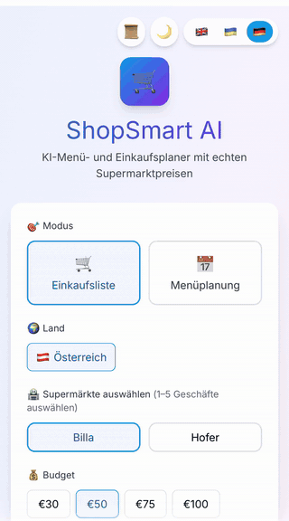
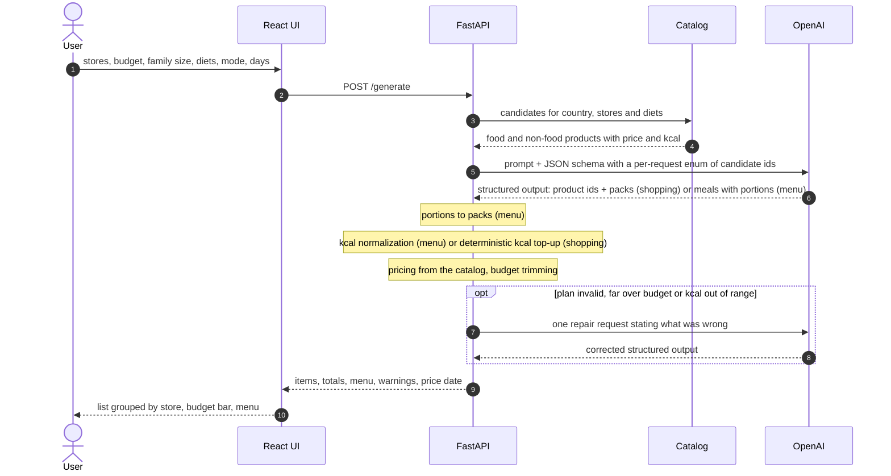
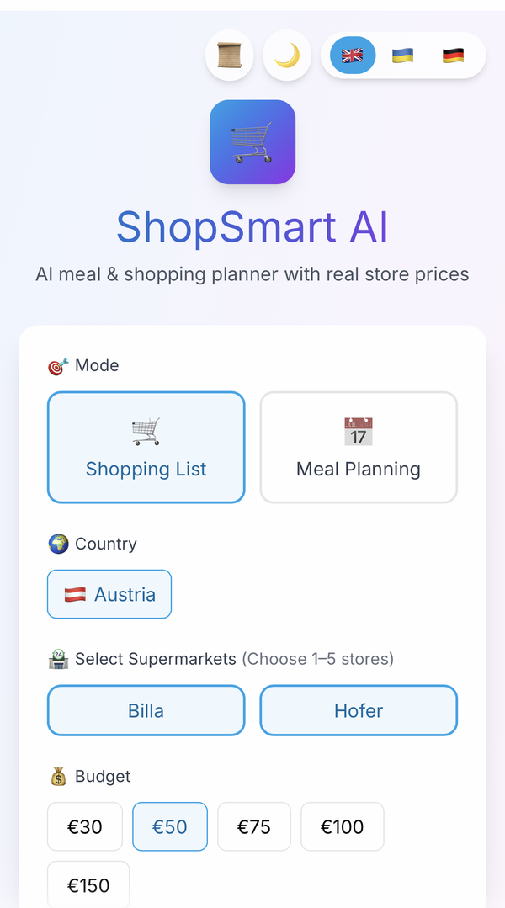
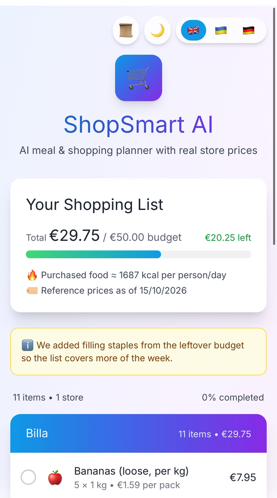
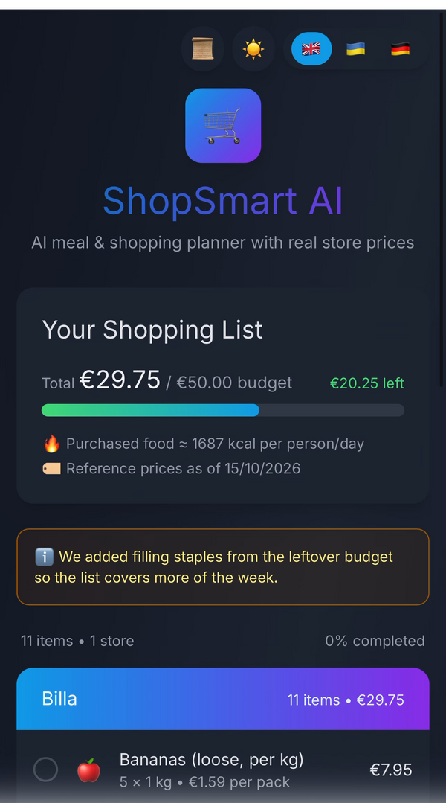
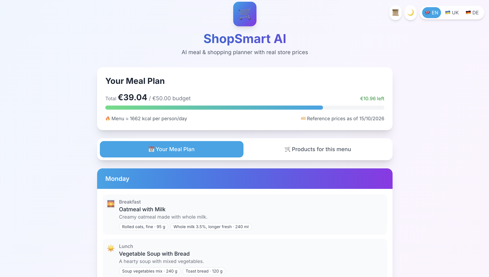

# ShopSmart AI

Budget-safe shopping lists and meal plans for Austrian supermarkets: an LLM picks the products, the server prices them from a dated catalog and guarantees the total fits your budget.

**[Live demo → shopsmart.sytnik-studio.com](https://shopsmart.sytnik-studio.com)**

[](https://github.com/IvanSytnik/shopsmart-ai/actions/workflows/ci.yml)

<p align="center"></p>

## The problem with v1

The first version (2025) asked the model for a complete shopping list as free text and parsed the JSON out of it. The model **invented prices and calorie values**, the total was whatever the model wrote, and **the budget was never checked**: a "€50" list could cost €70 in a real store, or feed a family for two days instead of seven. Nothing in the response could be traced back to a real price.

## How it works: the LLM chooses, the server computes

The model never writes a price, a total or a calorie number. It only picks product ids from a candidate list and says how much of each; everything numeric is done in Python from the catalog.



Deterministic guarantees (enforced by the server and covered by tests, independent of what the model returns):

- **Total ≤ budget.** If the priced plan is over budget, the server trims packs, then whole lines (snacks, drinks, frozen and non-food first). Every cut is listed in `trimmed`.
- **Diet filter.** Only products carrying every chosen diet tag (vegetarian, vegan, gluten-free, lactose-free) are offered to the model, and the id enum means nothing else can come back (non-food such as cleaning products is always allowed).
- **Only catalog products.** Product ids are a JSON-schema enum built per request from the candidates; unknown ids are rejected.
- **kcal floor of 1600 per person and day.** In menu mode, portions are scaled up (or down above 3500) to land in range. In shopping mode, the server tops the list up one pack at a time with the food that gives the most kcal per € while the budget allows (`kcal_topped_up`). If the floor can't be reached within the budget, the response carries a `low_kcal` warning instead of breaking the budget.

The full pipeline (candidate selection on tight budgets, portion rules, repair conditions, trimming order, top-up limits), request and response fields and error codes are in [docs/API.md](docs/API.md).

## Measured quality

20 fixed scenarios (shopping and menu mode, 1–7 days, 1–5 people, €15–150, every diet, en/de/uk, two deliberately tight budgets), real OpenAI calls, real catalog. Baseline = first run of the v2 pipeline; final = the release.

| Metric | Baseline [`20261015T141547Z`](backend/evals/results/20261015T141547Z.json) | Final [`20261017T151510Z`](backend/evals/results/20261017T151510Z.json) |
|---|---|---|
| Valid output rate | 100% | 100% |
| Budget adherence | 100% | 100% |
| Diet violations | 0 | 0 |
| Menu kcal in range | 54.5% | 90.9% |
| Shopping kcal in range (purchased) | n/a | 88.9% |
| First-attempt acceptance, shopping | 66.7% | 100% |
| First-attempt acceptance, menu | 54.5% | 81.8% |
| Latency p50 / p95 | 7.45 s / 21.21 s | 4.48 s / 14.18 s |
| Cost per request (avg) | $0.00143 | $0.00108 |

Budget and diet were already guaranteed in the baseline, because the server enforces them. Between the two runs the work went into plan quality: on tight budgets the most expensive calories are no longer offered to the model (vegetables and fruit exempt); small overshoots (≤ 10%) are trimmed instead of triggering a repair round trip; the menu output got shorter with `max_tokens` sized per request; menus are kcal-normalized by scaling portions; and shopping lists get a deterministic kcal top-up (6 of 9 lists were topped up). Runs that needed trimming went from 7 to 1, and fewer repairs mean lower latency and cost.

The remaining misses are honest ones. The shopping miss is `shop-en-hofer-2p-40-lactose-free` (2 people, €40/week, lactose-free, Hofer only): the top-up spent the budget down to €39.74 and reached 1200 kcal per person and day, so the API returns `low_kcal` rather than going over budget. The menu miss is the deliberately tight `tight-menu-en-both-5p-3d-40` (5 people, 3 days, €40): 1389 kcal, `low_kcal` + `budget_trimmed`. The tightest shopping case, €15/week for one person, reached 1671 kcal after the top-up.

Reports: [backend/evals/report.md](backend/evals/report.md) (latest run, per-case table) and [backend/evals/results/](backend/evals/results/) (raw JSON for every run).

## Features

- **Two modes**: a 7-day shopping list, or a 1–7 day menu (breakfast, lunch, dinner, snack) with the shopping list derived from its portions.
- **Grounded prices**: per-store subtotals, a budget bar (used / remaining) and the catalog's price date on every plan.
- **Honest warnings**: trimmed products, kcal top-up and low-kcal notices.
- **Share links**: the whole plan is compressed into the URL fragment (`/#/plan/<data>`) and opens read-only; nothing is stored on the server.
- **History** of recent plans in `localStorage`; check off items while shopping; copy or print.
- **i18n**: English, Ukrainian and German, product names in all three, plurals via `Intl.PluralRules` (e.g. uk: 1 день, 3 дні, 5 днів).
- **Dark mode**, **mobile layout**, **accessibility**: labelled form controls and groups, `aria-pressed` toggle chips, `aria-invalid` fields with linked error text.

## Tech stack

- **Backend**: Python 3.11+, FastAPI, Pydantic v2 + pydantic-settings, OpenAI Python SDK (`AsyncOpenAI`, Structured Outputs), slowapi, pytest, ruff.
- **Frontend**: React 18, TypeScript (strict), Vite, Tailwind CSS, lz-string (share links), Vitest + Testing Library, ESLint.
- **Infra**: Docker, nginx, GitHub Actions, Google Cloud Run, Cloudflare Pages.

## Folder overview

```
backend/
  app/
    main.py, config.py     # app factory, middleware; env-driven Settings
    api/                   # routers: health, generate, catalog
    schemas/               # request/response and LLM output models
    services/              # llm, planner (prompt + repair), pricing, portions, catalog, limits
    data/catalog.json      # generated price catalog (do not edit by hand)
  data_src/catalog_at.csv  # human-editable catalog source
  scripts/build_catalog.py # CSV -> catalog.json, with validation
  tests/                   # pytest, OpenAI always mocked
  evals/                   # offline eval runner, cases, reports
frontend/
  src/                     # components/, hooks/, api.ts, share.ts, history.ts, translations.ts, types.ts
deploy/                    # Cloud Run scripts and deployment guide
docs/                      # API reference, catalog notes, roadmap, media
```

## Run locally

### Docker Compose

```bash
export OPENAI_API_KEY=sk-...
docker compose up --build
```

Frontend at http://localhost, API at http://localhost:8000.

### Manual

```bash
# backend
cd backend
python -m venv .venv && source .venv/bin/activate
pip install -r requirements.txt -r requirements-dev.txt
cp .env.example .env               # set OPENAI_API_KEY
uvicorn app.main:app --reload --port 8000

# frontend (second terminal)
cd frontend
npm ci
cp .env.example .env.local         # VITE_API_URL=http://localhost:8000
npm run dev                        # http://localhost:3000
```

API docs at http://localhost:8000/docs when `ENVIRONMENT=development`. For development without the real catalog, `CATALOG_PATH=tests/fixtures/catalog_small.json` uses the made-up test catalog.

<details>
<summary>Backend environment variables</summary>

```env
OPENAI_API_KEY=sk-your-api-key            # required
OPENAI_MODEL=gpt-4o-mini                   # default
OPENAI_TEMPERATURE=0.7                     # default
SHOPPING_MAX_TOKENS=1200                   # default; output token limit for a shopping list
MENU_MAX_TOKENS_BASE=600                   # default; menu limit = base + per_day × days
MENU_MAX_TOKENS_PER_DAY=450                # default
OPENAI_TIMEOUT_S=40                        # default; per OpenAI request
OPENAI_MAX_RETRIES=0                       # default; SDK retries on connection/5xx errors
REQUEST_DEADLINE_S=55                      # default; total time for one POST /generate
REPAIR_MIN_REMAINING_S=20                  # default; skip the repair retry if less is left
CATALOG_PATH=app/data/catalog.json         # default; price catalog, validated at startup
MIN_KCAL_PER_PERSON_DAY=1600               # default; menu mode repairs plans below this, shopping mode tops up
TOP_UP_MAX_PACKS_PER_PRODUCT=3             # default; shopping kcal top-up: packs added per product
TOP_UP_MAX_KCAL_SHARE=0.35                 # default; shopping kcal top-up: max share of one product in the target kcal
TOP_UP_IN_LIST_MIN_RATIO=0.7               # default; shopping kcal top-up: list items win at this share of the best kcal/€
MAX_KCAL_PER_PERSON_DAY=3500               # default; menu mode repairs portions above this
TIGHT_BUDGET_PER_PERSON_DAY=7.0            # default; below it costly calories aren't offered (0 = off)
TRIM_TOLERANCE=0.10                        # default; up to 10% over budget is trimmed, not repaired
MAX_SCHEMA_ENUM_VALUES=500                 # default; above it product ids aren't an enum in the LLM schema
CORS_ORIGINS=http://localhost:3000         # comma-separated; "*" is rejected
RATE_LIMIT=10/minute                       # default; per client IP on POST /generate
DAILY_GENERATE_CAP=200                     # default; POST /generate calls per UTC day
ENVIRONMENT=development                    # development | production (production disables /docs, /redoc, /openapi.json)
FORWARDED_ALLOW_IPS=127.0.0.1              # read by uvicorn; proxies trusted for X-Forwarded-For
```

Docker Compose sets `CORS_ORIGINS=http://localhost,http://localhost:3000` by default. Behind a reverse proxy, set `FORWARDED_ALLOW_IPS` to the proxy's address so the rate limit sees the real client IP.

Frontend: `VITE_API_URL` is read at build time; `npm run dev` falls back to `http://localhost:8000`, production builds must set it.

</details>

### Price catalog

`backend/app/data/catalog.json` is generated from `backend/data_src/catalog_at.csv`; sources and disclaimer in [docs/CATALOG.md](docs/CATALOG.md).

```bash
cd backend
python scripts/build_catalog.py          # validate the CSV and write app/data/catalog.json
python scripts/build_catalog.py --check  # fail if catalog.json is out of date (CI)
```

## Tests

```bash
cd backend
pytest -q                                 # 359 tests, OpenAI mocked, no network
ruff check . && ruff format --check .
python scripts/build_catalog.py --check

cd frontend
npm run lint && npm run build && npm run test -- --run   # 92 tests in 10 files
```

CI ([.github/workflows/ci.yml](.github/workflows/ci.yml)) runs all of these on every push and pull request to `main`; it needs no secrets.

## Evals

Offline, real OpenAI calls, not part of CI:

```bash
cd backend
.venv/bin/python -m evals.run                # all 20 scenarios from evals/cases.yaml
.venv/bin/python -m evals.run --cases 2      # only the first 2
.venv/bin/python -m evals.run --cases menu-de-hofer-2p-1d-20,menu-en-both-2p-1d-25   # by id
.venv/bin/python -m evals.run --repeat 3     # every scenario 3 times
```

The runner calls the planner in-process with `OPENAI_API_KEY` from the environment or `backend/.env`. A full run makes 20–40 OpenAI calls and costs about $0.02 with the default model (the last one: $0.0216; prices in `PRICES_PER_M_TOKENS` in `evals/run.py`). It writes `evals/results/<timestamp>.json` and `evals/report.md`, and exits with 1 if any plan is over budget or breaks a requested diet.

## Deployment

- **API**: Google Cloud Run, `europe-west1`, scale 0–1 instances, OpenAI key from Secret Manager — https://shopsmart-api-326244330515.europe-west1.run.app
- **Frontend**: Cloudflare Pages, built from GitHub — https://shopsmart.sytnik-studio.com (also https://shopsmart-ai.pages.dev)

```bash
PROJECT_ID=my-project CORS_ORIGINS=https://shopsmart.sytnik-studio.com ./deploy/deploy_backend.sh
./deploy/smoke.sh <api_url> <frontend_url>   # one real /generate call
```

Step-by-step setup (OpenAI and GCP limits, secrets, Pages, custom domain, CORS, logs, rollback): [deploy/README.md](deploy/README.md).

## Security

- **Strict CSP** without `unsafe-eval` or `unsafe-inline` scripts (`script-src 'self'`, `frame-ancestors 'none'`, `connect-src` limited to the API origin), plus `X-Content-Type-Options`, `Referrer-Policy`, `X-Frame-Options: DENY` ([frontend/security-headers.conf](frontend/security-headers.conf)).
- **Rate limit** per client IP on `POST /generate` (`RATE_LIMIT`, default 10/minute) and a **daily generation cap** (`DAILY_GENERATE_CAP`, default 200 per UTC day).
- **OpenAI key in Secret Manager**, never in the image or the repo; a **separate OpenAI project** with its own spend limit.
- **Generic error responses** (`{"detail", "code"}`); the real exception is only logged server-side.
- Input validation with Pydantic (enums, bounds, length limits); user preferences are passed to the model as quoted data; CORS restricted to `CORS_ORIGINS`; `/docs` disabled in production.

## Limitations

- **Reference prices**, collected on 2026-10-15, for **Billa and Hofer only** (Austria). Real shelf prices and promotions differ. Spar and Lidl Austria had no machine-readable prices (see [docs/CATALOG.md](docs/CATALOG.md)); the API supports a `DE` country, but the catalog has no German stores yet.
- **Nutrition from standard tables**, not from each product's label.
- **In-memory rate limit and daily cap**: correct only for a single instance (hence `max-instances=1`); counters reset on restart.
- **Share links can get long** for large plans; links over 8000 characters are refused (copy or print instead).

## Screenshots

<table><tr>
<td></td>
<td></td>
<td></td>
</tr></table>



## Roadmap / Later

v2 is complete except the release tag. Next ideas: more chains (Spar, Lidl AT, German stores), price updates with freshness checks, short share links with server-side storage, a least-privilege runtime service account and a custom API domain. Full list: [docs/ROADMAP.md](docs/ROADMAP.md). Changes per version: [CHANGELOG.md](CHANGELOG.md).

## Academic note

ShopSmart AI started as an MSc diploma project at NTU "KhPI" (Department of Project Management in IT), 2025, by Ivan Sytnik (КН-М524), supervised by Kharchenko A.O. In 2026 it was reworked as v2 around grounded pricing, server-side budget enforcement and measured quality.

## License

MIT, see [LICENSE](LICENSE). Contact: [@IvanSytnik](https://github.com/IvanSytnik).
